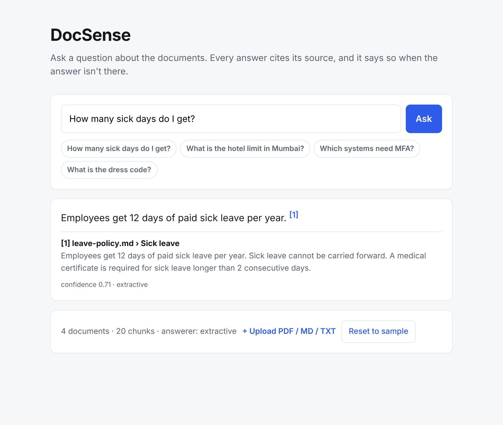
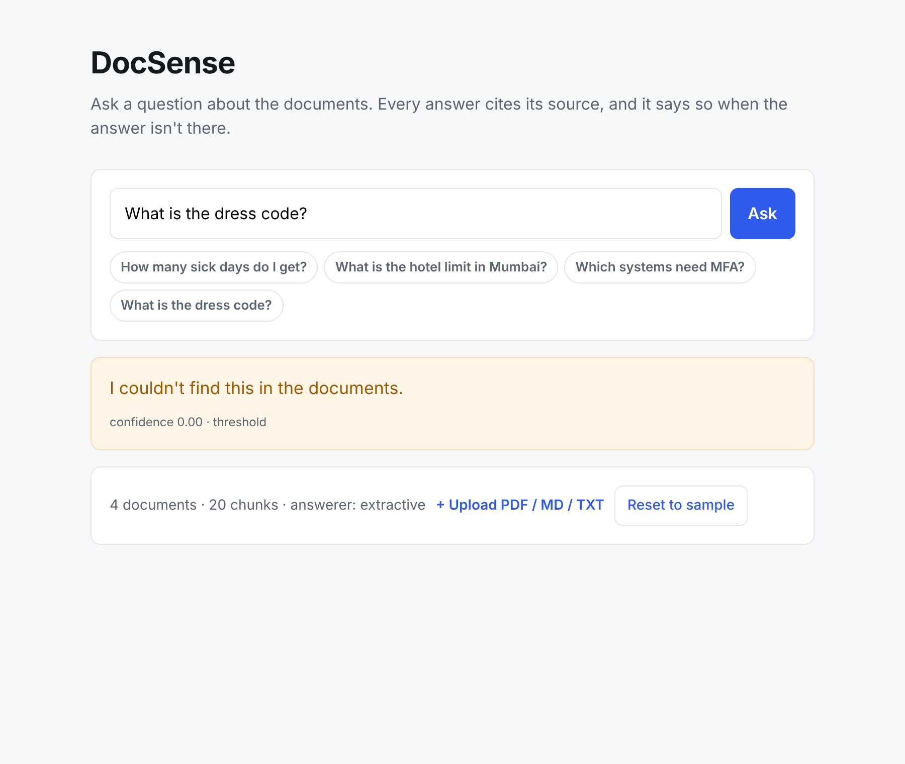

# DocSense

**Ask questions about your documents and get answers that cite their source, or an honest "I couldn't find this".**

**Live demo: [docsense-6bcu.onrender.com](https://docsense-6bcu.onrender.com)** (free hosting: the first visit can take ~50 s to wake up)


DocSense is a retrieval-augmented generation (RAG) app. Upload PDFs, Markdown or text files, ask a question, and it answers from the documents only. Every sentence links to the exact file and section it came from. When the documents don't contain the answer, it says so instead of guessing.

It ships with an **evaluation suite**: 43 labelled questions (including 10 that are deliberately *not* answerable), and a script that measures retrieval quality, refusal behaviour and answer accuracy. Every design choice below is backed by a number from that suite.

| Answer with a citation | Refusing when the answer isn't there |
|---|---|
|  |  |

## Results

From [`evals/results.md`](evals/results.md), generated by `python -m evals.run_evals` (runs in CI on every push):

| Metric (offline, no API key) | Result |
|---|---|
| Right section ranked first (Hit@1) | 85% |
| Right section in top 3 (Hit@3) | 97% |
| Answer contains the expected fact | **85%** |
| Answer cites the right section | 85% |
| Unanswerable questions correctly refused | **100%** |
| Made-up answers | **0** |

## How it works

```
upload ──► split into sections/pages ──► chunk (≤600 chars, 1-sentence overlap)
                                                   │
question ──► hybrid retrieval (BM25 + TF-IDF [+ Gemini embeddings]) ──► top 4 chunks
                                                   │
                         confidence = ½ relevance + ½ query coverage
                                                   │
                     below 0.38? ──► "I couldn't find this in the documents."
                                                   │
                     answer from numbered sources ──► check citations ──► cited answer
```

1. **Ingest** (`docsense/ingest.py`): Markdown is split by heading and PDFs by page, so every chunk has exactly one citation (`travel-and-expenses.md › Hotel limits`, `handbook.pdf p.4`).
2. **Retrieve** (`docsense/retrieval.py`): BM25 (written from scratch) and TF-IDF cosine similarity, combined with Reciprocal Rank Fusion. With a `GEMINI_API_KEY`, Gemini embeddings join the fusion.
3. **Decide** (`docsense/pipeline.py`): before calling any LLM, DocSense checks whether the best passage really covers the question. *Query coverage* is the share of the question's meaning (IDF-weighted words) that appears in the passage.
4. **Answer** (`docsense/answer.py`):
   - **Gemini** (when a key is set) answers only from numbered sources. Citations that point at sources that don't exist are removed, and an answer with no valid citation is refused.
   - **Extractive** (no key needed) picks the best-matching sentences and cites them. It cannot invent text, which makes it a useful baseline.

## Decisions I made, and why

- **Refuse before calling the LLM.** Retrieval relevance alone could not separate answerable from unanswerable questions: "dress code" still retrieves *something*. Adding query coverage took correct refusals **from 50% to 100%** and cut made-up answers **from 5 to 0** on the eval set. The threshold (0.38) is the value that best balances the two in the sweep table in `evals/results.md`.
- **Chunks never cross a section or page.** One chunk = one citation, so a citation can never point at the wrong place.
- **Hybrid retrieval as the default, even though TF-IDF alone scored slightly higher offline** (Hit@1 88% vs 85%). Hybrid is what lets Gemini embeddings plug in when a key is available, and RRF makes adding a retriever a one-line change. The offline numbers are reported as they are.
- **Chunk size barely mattered** (300 / 600 / 1000 chars all scored the same), because policy sections are short. I kept 600 as a middle ground for longer PDFs.
- **No vector database.** For a few hundred chunks, in-memory NumPy/scikit-learn is faster and simpler. A store like pgvector or Qdrant becomes worth it at tens of thousands of chunks.

## Known limitations

The 5 questions it still gets wrong are all **vocabulary gaps**: the question uses different words from the document ("vacation" vs "annual leave", "fathers" vs "paternity", "Dubai" vs "outside India"). Keyword methods can't bridge that; this is what embedding-based retrieval is for. The next step is running the eval with `--llm` to measure how much Gemini embeddings close the gap.

Other limitations: uploaded documents are shared by all visitors to one running instance (fine for a demo, not for multiple users), and scanned PDFs need OCR first.

## Run it

```bash
python -m venv .venv && source .venv/bin/activate
pip install -r requirements-dev.txt
uvicorn docsense.api:app --reload        # open http://localhost:8000
```

Optional: copy `.env.example` to `.env` and add a free [Gemini API key](https://aistudio.google.com/apikey) to switch on LLM answers and embeddings.

```bash
pytest -q                                # 20 tests, no network needed
python -m evals.run_evals                # regenerate evals/results.md
GEMINI_API_KEY=... python -m evals.run_evals --llm   # also score Gemini answers
```

**API:** `POST /ask {"question": "..."}` · `POST /documents` (file upload) · `DELETE /documents` (reset) · `GET /health`. Interactive docs at `/docs`.

**Deploy:** the repo includes a `Dockerfile` and `render.yaml`. On [Render](https://render.com), choose *New → Blueprint*, select this repo, and add `GEMINI_API_KEY` if you want LLM answers.

## Project structure

```
docsense/        ingest, retrieval, pipeline, answer, llm client, FastAPI app + static UI
data/sample/     4 sample policy documents (fictional company)
evals/           labelled dataset, eval runner, results.md
tests/           unit + API tests (Gemini mocked)
```

---
Built by [Kunal Bhoomaraddi](https://github.com/kunalbhoomaraddi-cpu) · MIT License
